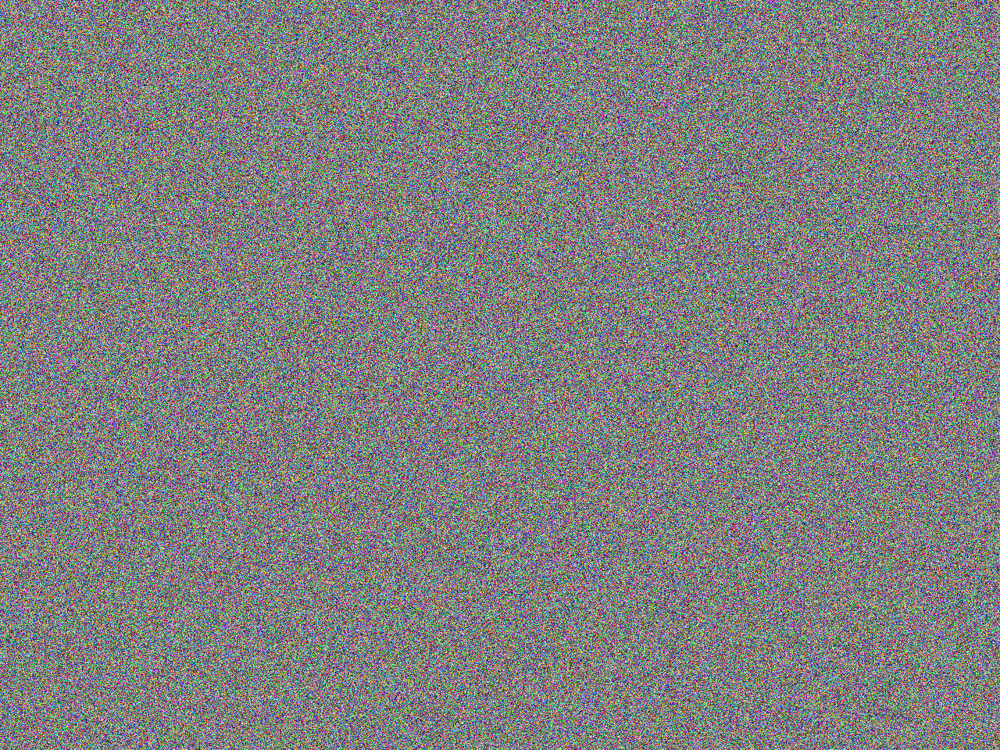
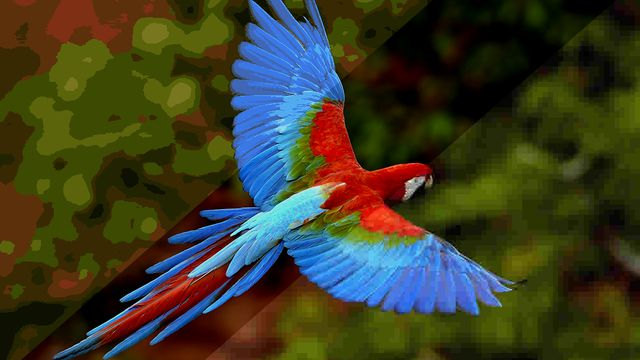
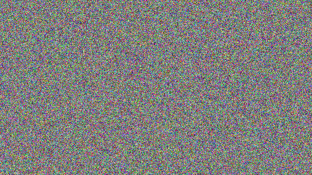
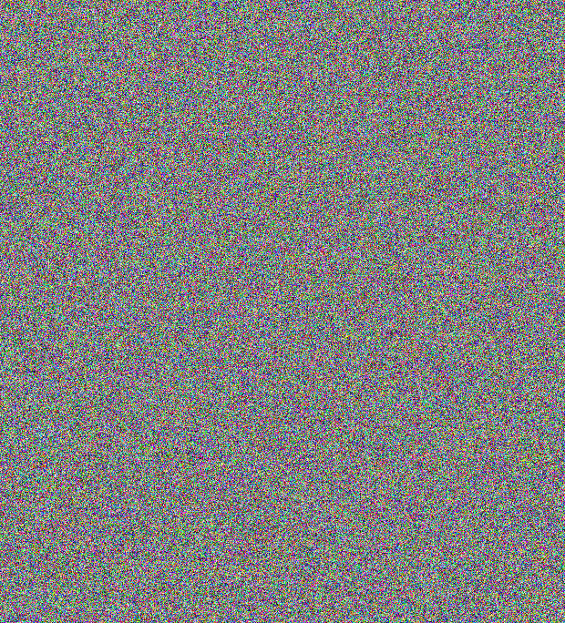
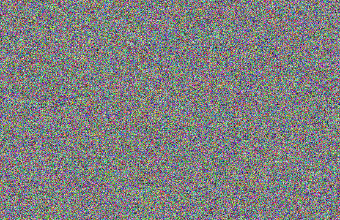

# Bagunceitor — Confusão e Difusão de Imagens em C

**Disciplina:** Programação de Baixo Nivel
**Alunos:** Dimitri Callegari Jadovski e João Gabriel Cirne
**Repositório:** https://github.com/Dimigol/T1-baixo-nivel
**Vídeo de apresentação:** https://youtu.be/NR_XKA4Wm8U

---

## 1. Objetivo

Embaralhar uma imagem RGB de forma que ela fique irreconhecível e, em seguida,
recuperá-la **exatamente** (bit a bit) aplicando as operações inversas. O
embaralhamento combina as duas ideias de Shannon:

- **Confusão (C):** altera o *valor* de cada byte, sem mover pixels.
- **Difusão (D):** altera a *posição* de cada pixel, sem mudar seu valor.

Fluxo completo:

```
original ──C──► confundida ──D──► baguncada.png
baguncada ──D⁻¹──► confundida ──C⁻¹──► recuperada.png  (== original)
```

A inversão acontece na ordem contrária (D⁻¹ antes de C⁻¹), como em qualquer
composição de funções: (D ∘ C)⁻¹ = C⁻¹ ∘ D⁻¹.

## 2. Compilação e execução

```bash
make
./bagunceitor predio32.jpg
```

O programa gera `baguncada.png` e `recuperada.png` e compara a recuperada com a
original byte a byte, mostrando `SUCESSO` ou as diferenças encontradas.

## 3. Gerador pseudoaleatório (chave)

As duas transformações usam um gerador **xorshift64** com semente fixa:

```c
x ^= x << 13;  x ^= x >> 7;  x ^= x << 17;
```

Por ser determinístico, a mesma semente sempre produz a mesma sequência. Assim
a ida e a volta geram exatamente as mesmas chaves sem precisar armazená-las:
**a semente funciona como a chave secreta**. Confusão e difusão usam sementes
diferentes (`SEMENTE_CONFUSAO` e `SEMENTE_DIFUSAO`), para que as duas
sequências sejam independentes.

## 4. Estratégia de Confusão

### Transformação

Para cada byte `b` da imagem (R, G e B de todos os pixels), gera-se uma chave
`k` diferente (8 bits do xorshift) e aplicam-se três passos:

| Passo | Operação | Efeito |
|---|---|---|
| 1 | `x = b XOR k` | mistura o byte com a chave |
| 2 | `x = rotl(x, 3)` | espalha os bits dentro do byte |
| 3 | `x = x · 167 + k (mod 256)` | transformação afim, altera todos os bits de forma não linear em relação ao XOR |

### Inversa

Os passos são desfeitos na ordem contrária:

| Passo | Operação inversa |
|---|---|
| 3⁻¹ | `x = (y − k) · 23 (mod 256)` |
| 2⁻¹ | `x = rotr(x, 3)` |
| 1⁻¹ | `b = x XOR k` |

### Justificativa

- **XOR** é sua própria inversa: `(b ⊕ k) ⊕ k = b`.
- **Rotação** de 3 bits para a esquerda é desfeita por rotação de 3 para a
  direita; nenhum bit é perdido (diferente de um *shift*).
- **Multiplicação mod 256** só é inversível se o multiplicador for ímpar
  (coprimo com 256). 167 é ímpar e `167 · 23 = 3841 = 15 · 256 + 1`, logo
  `23` é o inverso multiplicativo de 167 módulo 256.
- Como cada byte depende apenas do seu próprio valor e da sua posição (que
  define `k`), a confusão pode ser feita **no lugar**, sem buffer extra.
- Como `k` muda a cada byte, duas regiões de cor uniforme (ex.: céu) geram
  valores totalmente diferentes, o que elimina o padrão visual da imagem.

**Limitação conhecida:** cada byte cifrado depende só do byte original
correspondente; não há efeito avalanche entre pixels vizinhos (alterar um
pixel da original altera apenas um pixel da cifrada).

## 5. Estratégia de Difusão

### Transformação (permutação)

1. Cria-se um vetor `perm` com as posições `0, 1, …, tam−1`.
2. Esse vetor é embaralhado com o algoritmo **Fisher-Yates**, usando o
   xorshift com a semente da difusão:
   ```c
   for (i = tam-1; i > 0; i--) { j = rand % (i+1); troca(perm[i], perm[j]); }
   ```
3. Cada pixel da posição `i` é copiado para a posição `perm[i]`:
   `dest[perm[i]] = orig[i]`.

### Inversa

Gera-se a **mesma** permutação (mesma semente) e faz-se o caminho contrário:
`dest[i] = orig[perm[i]]`.

### Justificativa

- Fisher-Yates só faz trocas entre elementos do vetor, então `perm` contém
  cada posição **exatamente uma vez**: é uma bijeção, e toda bijeção tem
  inversa.
- A difusão move **pixels inteiros** (struct `Pixel`, 3 bytes), mantendo R, G e
  B juntos, o que espalha a estrutura espacial da imagem por todo o quadro.
- Origem e destino são buffers **separados**: fazer a permutação no lugar
  sobrescreveria pixels ainda não lidos.
- O vetor `perm` é gerado novamente na volta em vez de ser guardado, pois só a
  semente é necessária.

### O que é autoral na difusão

O Fisher-Yates é um algoritmo clássico de embaralhamento, que usamos apenas
como ferramenta para gerar uma permutação sem repetições. A regra de difusão
em si é a forma como o grupo o combinou com o resto do trabalho. Em vez de
usar o `rand()` da biblioteca, que muda entre sistemas e compiladores, ligamos
o embaralhamento ao nosso próprio gerador xorshift, e a semente
`SEMENTE_DIFUSAO` passa a funcionar como chave: quem não conhece a semente não
sabe para onde cada pixel foi. A difusão usa uma semente diferente da
confusão, para que as duas etapas sejam independentes. Além disso, ela move
pixels inteiros em vez de bytes soltos: só muda posições e deixa toda a
alteração de valores para a confusão, o que mantém as duas etapas com papéis
separados e fáceis de inverter.

**Observação:** `rand % (i+1)` tem um viés de módulo desprezível (o gerador
tem 64 bits e a imagem ~1,2 milhão de pixels).

## 6. Manipulação de Memória

- A imagem é carregada pelo `stbi_load` forçando 3 canais, e o buffer é
  interpretado como um vetor de `Pixel`.
- Um `_Static_assert(sizeof(Pixel) == 3)` garante em tempo de compilação que a
  struct não tem padding, o que permite tratar o mesmo buffer como
  `unsigned char*` na confusão (byte a byte) e como `Pixel*` na difusão
  (pixel a pixel).
- Todo o acesso usa **aritmética de ponteiros**, por exemplo:
  ```c
  unsigned char* p = (unsigned char*)img;
  *(p + i) = (unsigned char)(x * MULT_CONFUSAO + k);   // confusão
  *(dest + *(perm + i)) = *(orig + i);                  // difusão
  ```
- Tamanhos e índices usam `size_t`, evitando overflow em imagens grandes.
- Buffers alocados (`malloc`):

  | Buffer | Tamanho | Uso |
  |---|---|---|
  | `in.pixels` | `w·h·3` | original (alocado pelo `stbi_load`, liberado com `stbi_image_free`) |
  | `out.pixels` | `w·h·3` | confundida → no final, recuperada |
  | `rec.pixels` | `w·h·3` | embaralhada (C + D) |
  | `perm` | `w·h·sizeof(size_t)` | permutação temporária, liberada após cada uso |

  Todas as alocações são verificadas e todos os buffers são liberados.

## 7. Recuperação e Verificação

A função `imagens_iguais` compara a original com a recuperada **byte a byte**
(`w·h·3` comparações). Se houver diferença, mostra as 10 primeiras e o total.

O programa foi testado com quatro imagens de tamanhos e conteúdos diferentes:

| Imagem | Dimensões | Resultado |
|---|---|---|
| `predio32.jpg` | 1280 × 960 | `SUCESSO: imagem recuperada e identica a original.` |
| `arara.jpg` | 640 × 360 | `SUCESSO: imagem recuperada e identica a original.` |
| `lago.jpg` | 620 × 684 | `SUCESSO: imagem recuperada e identica a original.` |
| `cachorro.jpg` | 556 × 359 | `SUCESSO: imagem recuperada e identica a original.` |

## 8. Resultados

| Imagem | Original | Embaralhada | Recuperada |
|---|---|---|---|
| Prédio |  |  |  |
| Arara |  |  |  |
| Lago |  |  |  |
| Cachorro |  |  |  |

Em todos os casos a imagem embaralhada tem aparência de ruído uniforme e a
recuperada é idêntica à original. As imagens foram escolhidas para testar
situações diferentes:

- **Cachorro:** o fundo rosa é uma grande área de cor quase uniforme, o caso
  mais difícil para a confusão. Como a chave `k` muda a cada byte, pixels
  iguais viram valores diferentes, e na embaralhada não sobra nenhum vestígio
  do fundo nem do contorno do animal. Se a chave fosse a mesma para todos os
  bytes, o fundo continuaria com uma cor só e a silhueta do cachorro (depois da
  difusão, uma "nuvem" de pixels de cor diferente) denunciaria a imagem.
- **Lago:** a imagem tem uma simetria forte (o reflexo das árvores na água),
  que também desaparece por completo depois da difusão.
- **Arara:** cores muito saturadas (azul, vermelho e verde); na embaralhada a
  distribuição de cores fica homogênea, sem predominância visível.
- **Dimensões variadas:** larguras ímpares (359, 556) e que não são potências
  de 2 confirmam que a confusão e a permutação não dependem do tamanho da
  imagem.

## 9. Conclusão

O trabalho mostrou na prática que uma imagem, na memória, é só uma sequência
de bytes, e que o significado desses bytes depende do tipo do ponteiro usado
para lê-los. O mesmo buffer foi tratado como `unsigned char*` na confusão, para
alterar cada canal individualmente, e como `Pixel*` na difusão, para mover os
três canais de um pixel juntos. Isso só é seguro porque a struct não tem
padding, o que levou ao uso do `_Static_assert`: uma suposição sobre o layout
da memória que antes era implícita passou a ser verificada pelo compilador.

Também ficou claro por que a ordem das inversas importa. A imagem embaralhada
é o resultado de `D(C(original))`, então para voltar é preciso desfazer
primeiro a última operação aplicada (D⁻¹) e só depois a primeira (C⁻¹). Se a
ordem fosse trocada, a confusão inversa usaria as chaves de cada posição sobre
pixels que ainda estão nas posições erradas, e a recuperação falharia. O mesmo
vale dentro da própria confusão: os passos XOR → rotação → afim são desfeitos
na ordem afim⁻¹ → rotação⁻¹ → XOR.

As principais dificuldades foram:

- **Canais da imagem:** uma imagem com canal alpha (4 canais) desalinharia a
  struct `Pixel`; a solução foi forçar 3 canais no `stbi_load`.
- **Tipos e overflow:** índices `int` podem estourar em imagens grandes
  (`w · h · 3`), por isso todos os tamanhos e índices passaram a usar `size_t`.
- **Permutação no lugar:** mover pixels dentro do mesmo buffer sobrescrevia
  pixels ainda não lidos; a solução foi usar buffers separados de origem e
  destino.
- **Inverso modular:** escolher um multiplicador que tivesse inverso módulo 256
  exigiu entender que ele precisa ser ímpar.

Por fim, a verificação byte a byte foi essencial: uma imagem "parecida" com a
original não basta, e só a comparação exata garante que todas as operações são
de fato inversíveis.

## 10. Uso de Inteligência Artificial

Durante o trabalho foi utilizado o assistente de IA **Claude** (Anthropic) como
apoio, nos seguintes pontos:

- **Organização do relatório:** sugestões de estrutura e de divisão em seções
  deste README, para deixar a explicação das regras, da manipulação de memória
  e da verificação mais clara.
- **Roteiro do vídeo:** ajuda para dividir a apresentação em cenas, distribuir
  as falas entre os integrantes e definir o que mostrar na tela em cada parte
  (imagem original, embaralhada, recuperada e a verificação byte a byte).
- **Melhoria da regra autoral:** discussão de ideias para tornar as regras de
  confusão e difusão mais eficazes. Por exemplo: por que trocar o primeiro
  pixel com o último (inverter a imagem) não esconde o conteúdo, por que o
  multiplicador da transformação afim precisa ser ímpar para ter inverso
  módulo 256, e como espalhar os pixels pela imagem toda em vez de deslocar
  apenas linhas ou colunas.

As sugestões foram avaliadas pelo grupo, e as regras finais foram escolhidas,
implementadas e testadas pelos integrantes, que conseguem explicar e
justificar cada etapa.
